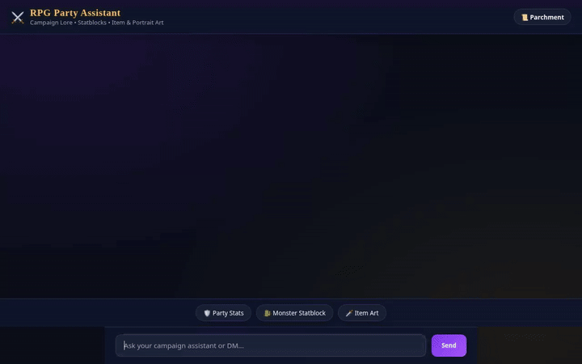

# RPG Party Assistant

An AI-powered Fantasy RPG Campaign & Party Assistant built on Google Cloud's Agent Development Kit (ADK) and Vertex AI Reasoning Engine. The agent helps Dungeon Masters and players manage spellbooks, party inventory, dice rolls, monster statblocks, item artwork, video generation, Python code execution, and cross-session memory recall.



---

## ⚔️ Key Features & Implemented Tools

The project implements the following active tools and capabilities:

- **📜 Spellbook & Inventory Persistence (Google Cloud Firestore)**
  - `query_spells(class_name, level)`: Search party spellbooks and known spells in Firestore (`spells` collection).
  - `query_inventory()`: Retrieve items stored in the party's Bag of Holding from Firestore (`inventory` collection).
  - `update_inventory(item_name, quantity, action)`: Add or remove items from the party inventory in Firestore.
  - `query_party_stats()`: Fetch party member attributes, Armor Class, Hit Points, and passive perception (`party_stats` collection).

- **🎲 Dice Rolling Engine**
  - `roll_dice(notation)`: Parse and execute standard RPG dice notation (e.g., `1d20+5`, `3d6`, `2d8+3`) with detailed individual rolls and modifiers.

- **🐉 Monster Statblock Lookup**
  - `lookup_monster_statblock(monster_name)`: Search official D20 monster statblocks for Armor Class, Hit Points, speeds, actions, and combat tactics.

- **🎨 Item Artwork Generation (Vertex AI Imagen 3)**
  - `generate_item_art(prompt)`: Generate high-resolution fantasy item artwork using `imagen-3.0-generate-002`, upload to Google Cloud Storage (`rpg-party-assets` bucket), and return a public HTTPS link.

- **🎬 Showcase Video Generation (Vertex AI Gemini Omni)**
  - `generate_item_video(item_name, description)`: Generate a 3D video showcase of legendary items using `gemini-omni-flash-preview` in the global region. Saves output to agent artifacts and uploads MP4 bytes directly to public Cloud Storage.

- **🐍 Python Sandbox Code Execution (Agent Engine)**
  - `PicklableAgentEngineSandboxCodeExecutor`: Execute Python code dynamically in an isolated Vertex AI Reasoning Engine sandbox for complex combat mathematics, encounter balance calculations, and loot distribution.

- **🧠 Cross-Session Memory Recall (ADK Memory Bank)**
  - `generate_memories_callback`: Automatically extract and persist party facts, user preferences, and equipment details into an ADK Memory Bank for cross-session recall.

- **✨ Structured A2UI UI Rendering**
  - Declarative A2UI basic catalog (v0.8) rendering. The agent outputs structured JSON UI components (`Card`, `Column`, `Row`, `Text`, `Image`) rendered cleanly by the custom frontend.

- **🔮 Parchment Light & Arcane Dark Frontend**
  - Lightweight FastAPI proxy server and responsive chat interface with a **Parchment Light / Arcane Dark** theme toggle and clickable suggestion pills.

---

## 🔮 Google Cloud Services & Integrations

- **Vertex AI Reasoning Engine**: Agent runtime hosting the ADK agent logic with lazy serialization.
- **Vertex AI Gemini 2.5 Flash**: Core LLM powering agent reasoning and tool orchestration.
- **Vertex AI Imagen 3**: Text-to-image model (`imagen-3.0-generate-002`).
- **Vertex AI Gemini Omni**: Multimodal model (`gemini-omni-flash-preview`) for video generation.
- **Google Cloud Firestore**: Serverless document database for spells, inventory, and party stats.
- **Google Cloud Storage**: Public media asset bucket hosting generated item images and showcase videos.
- **Agent Development Kit (ADK)**: Framework for memory banks, callbacks, and A2A interoperability.

---

## 🚧 Status of Planned Features

- **Sound Effect Generator**: *Planned, not yet implemented.*
- **Real-Time Voice Chat Mode**: *Planned, not yet implemented.*

---

## 🚀 Local Development Setup & Execution

### Prerequisites
- Python 3.11+
- `uv` package manager installed (`uvx google-agents-cli setup`)
- Google Cloud SDK authenticated with access to Vertex AI, Firestore, and Cloud Storage

### 1. Install Dependencies
```bash
uv sync
```

### 2. Set Environment Variables
```bash
export GOOGLE_CLOUD_PROJECT="<your-gcp-project-id>"
export AGENT_ENGINE_RESOURCE_NAME="projects/<project-number>/locations/us-east1/reasoningEngines/<engine-id>"
export AGENT_DIRECTORY="app"
export PORT=8080
```

### 3. Run the Local Web Frontend
```bash
cd frontend
uv run python main.py
```
Open a browser to port `8080` to access the chat UI.

### 4. Deploy to Vertex AI Agent Engine
To update and deploy the agent logic to Google Cloud Agent Engine:
```bash
agents-cli deploy --service-name weather-agent --no-confirm-project --project <your-gcp-project-id> --region us-east1
```
